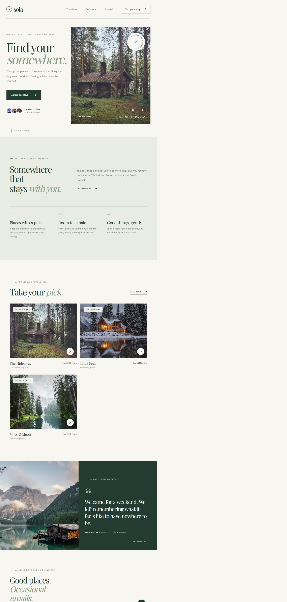

# Sola — Find your somewhere

Sola is a fictional collection of thoughtful places to stay, made for slower travel. This landing page introduces the brand, highlights its stays and values, shares a guest quote, and invites visitors to sign up for occasional updates.

The project uses plain HTML, CSS, and JavaScript. There is no framework, package manager, build process, or installation step.

## Full-page preview

The following desktop screenshot shows the page from the site header through the footer.



## Get started

### Open directly

Open `index.html` in a modern web browser.

### Run a local static server

From the project directory, start a server using any static-file server. For example, if Python is installed:

```powershell
python -m http.server 8000
```

Then visit <http://localhost:8000>. Stop the server with `Ctrl+C`.

## Page sections

- **Hero:** brand introduction, primary call to action, social proof, and a featured stay.
- **Our story:** a short introduction to the Sola approach and three guiding values.
- **Featured stays:** three accommodation cards with location and nightly price.
- **Guest quote:** a testimonial paired with a landscape photograph.
- **Newsletter:** an email-address field and sign-up interaction.
- **Footer:** brand sign-off and links to key sections.

The main navigation, hero buttons, stay links, and footer links use in-page anchors to take visitors to the relevant section.

## Interactions

- On narrow screens, the menu button opens and closes the navigation. Selecting a navigation link closes the menu.
- The newsletter form checks that an email address has been entered, then displays a confirmation message.
- The newsletter interaction is a front-end demonstration only. It does not send or store email addresses; connect it to a newsletter provider or backend to collect subscriptions.
- Stay cards and calls to action currently link to page sections rather than a booking service.

## Responsive design and accessibility

The layout adapts for mobile, tablet, and desktop viewports. Stay cards shift from one column on narrow screens to multiple columns on larger screens, and the mobile navigation uses an accessible expanded-state indicator.

The page includes semantic landmarks and headings, descriptive image text, a programmatically labelled email field, and a live region for form feedback. CSS respects the visitor’s reduced-motion preference.

## External assets

The page loads **DM Sans** and **Playfair Display** from Google Fonts and photographs from Unsplash. An internet connection is required for the remote fonts and images. The screenshot included in this repository is a local file and remains available offline.

## Project files

| File | Purpose |
| --- | --- |
| `index.html` | Semantic page structure, content, metadata, image references, and stylesheet/script links. |
| `style.css` | Color palette, typography, page layout, responsive breakpoints, interactive states, and reduced-motion styles. |
| `script.js` | Mobile menu behavior and client-side newsletter form feedback. |
| `screenshot.jpg` | Full-page desktop screenshot used in this README. |
| `README.md` | Project overview, run instructions, and implementation notes. |
